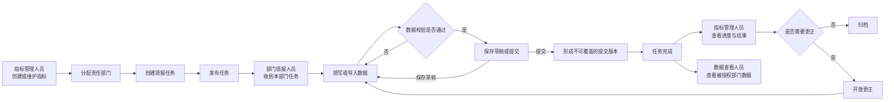
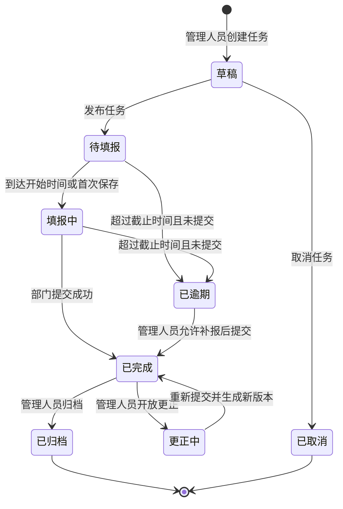

# 指标管理系统：业务流程与状态机（V0.1）

## 1. 本阶段要解决的问题

本阶段先不讨论页面样式，只确定：

- 谁发起业务。
- 谁在什么时间执行什么操作。
- 点击操作后数据进入什么状态。
- 不同角色在各状态下能看到什么、能做什么。

这些规则确认后，页面地图、Figma 线框图和后端接口才能保持一致。

## 2. 核心业务流程

## 3. 三类角色各自的工作路径

### 3.1 指标管理人员

1. 进入指标库，新建或维护指标。
2. 配置指标口径、单位、周期、计算方式和责任部门。
3. 创建填报任务，选择填报周期、截止时间、部门和指标。
4. 发布任务，系统向相关部门生成待填报任务。
5. 查看各部门进度，对未填报或已逾期部门进行催办。
6. 查看提交结果、版本记录和统计报表。
7. 如发现问题，开放指定部门、指定指标的更正权限。
8. 任务结束后归档。

### 3.2 部门填报人员

1. 进入“我的填报”，只能看到本部门任务。
2. 打开任务，查看指标口径和填报要求。
3. 手工填写或批量导入数据。
4. 系统进行必填、格式、范围和逻辑校验。
5. 校验通过后保存草稿或提交。
6. 提交后只能查看，不能直接修改原版本。
7. 管理人员开放更正后，基于上一版本生成新版本并重新提交。

### 3.3 数据查看人员

1. 进入数据看板或统计报表。
2. 系统只返回该用户被授权部门的数据。
3. 用户查看任务进度、汇总、趋势、对比和指标明细。
4. 用户可以在授权范围内导出，但不能修改任何数据。
5. 用户尝试通过链接访问未授权部门时，后端仍必须拒绝访问。

## 4. 填报任务状态机

## 5. 状态与允许操作

| 状态 | 指标管理人员 | 部门填报人员 | 数据查看人员 |
| --- | --- | --- | --- |
| 草稿 | 编辑、发布、取消 | 不可见 | 不可见 |
| 待填报 | 查看、催办、取消 | 查看、开始填报 | 按授权查看进度 |
| 填报中 | 查看进度、催办 | 填写、导入、保存、提交 | 按授权查看进度 |
| 已逾期 | 查看、催办、允许补报 | 只读；允许补报后可填写 | 按授权查看进度 |
| 已完成 | 查看、导出、开放更正、归档 | 查看已提交版本 | 按授权查看结果 |
| 更正中 | 查看更正进度、关闭更正 | 修改并重新提交 | 查看上一个有效版本 |
| 已归档 | 查看、导出 | 查看 | 按授权查看 |
| 已取消 | 查看取消原因 | 只读或不可见 | 默认不可见 |

## 6. 数据版本与更正规则

- 首次提交生成版本 V1。
- 已提交版本不可直接覆盖或删除。
- 开放更正时，系统复制上一版本形成编辑中的新版本。
- 重新提交后生成 V2、V3 等新版本。
- 默认统计报表只读取最新有效版本。
- 历史版本保留填报人、提交时间、更正原因和字段差异。
- 数据查看人员默认看到最新有效版本；是否允许查看历史版本可以单独授权。

## 7. 已确认的流程规则

系统不设置审核流程，不设置“待审核、审核通过、审核驳回”等状态，也不增加审核人员角色。

部门填报人员提交成功后，任务直接进入“已完成”。如提交数据存在问题，由指标管理人员针对指定部门和任务开放更正；部门填报人员修改后重新提交并生成新版本，原版本继续保留。

## 8. 下一步

本流程确认后，下一步制作页面地图和 Wireflow，明确：

- 三类角色分别有哪些菜单和页面。
- 每个页面的主要按钮。
- 点击按钮后打开哪个页面、弹窗或抽屉。
- 每条跳转发生的前置条件和结果状态。
