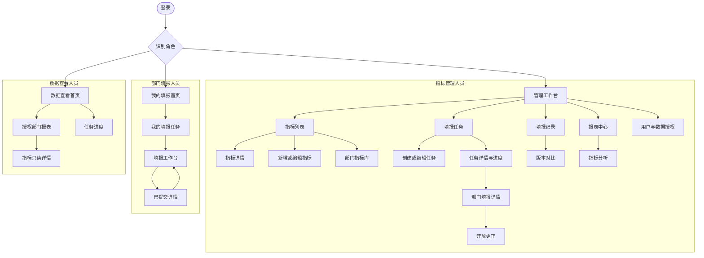
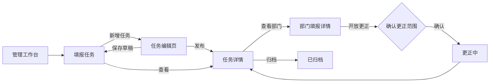
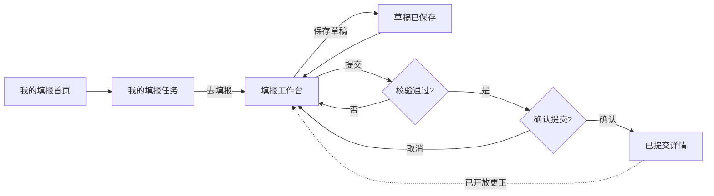
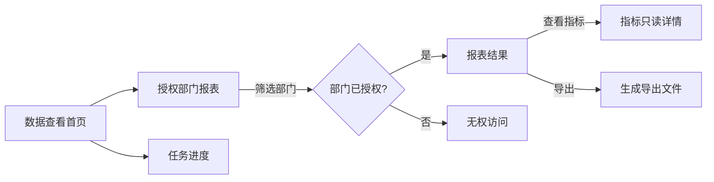

# 指标管理系统：页面地图与 Wireflow（V0.1）

## 1. 页面设计原则

- 登录后根据角色进入对应首页，不让不同角色看到无权使用的菜单。
- 数据权限由后端过滤；隐藏菜单和按钮只是前端表现，不能替代权限校验。
- 业务操作尽量从任务详情进入，避免用户在多个菜单之间寻找上下文。
- 新增、编辑等短操作使用弹窗或抽屉；包含多个步骤或大量字段时使用独立页面。
- 系统没有审核页面。部门提交成功后直接进入已完成状态。

## 2. 总页面地图

说明：已提交详情返回填报工作台的连线只在指标管理人员已经开放更正时生效。

## 3. 指标管理人员 Wireflow

## 4. 部门填报人员 Wireflow

## 5. 数据查看人员 Wireflow

## 6. 页面清单与主要功能

| 编号 | 页面 | 使用角色 | 主要内容 | 主要操作 |
| --- | --- | --- | --- | --- |
| P01 | 登录页 | 全部 | 登录、身份识别 | 登录 |
| P02 | 管理工作台 | 指标管理人员 | 指标数量、任务状态、部门进度、逾期提醒 | 查看任务、催办 |
| P03 | 指标列表 | 指标管理人员 | 指标查询、状态、责任部门 | 新增、查看、编辑、启停 |
| P04 | 指标详情 | 指标管理人员 | 基本信息、口径、历史数据、变更记录 | 编辑、返回 |
| P05 | 指标编辑页 | 指标管理人员 | 指标定义、周期、公式、口径 | 保存、取消 |
| P06 | 部门指标库 | 指标管理人员 | 部门与指标的分配关系 | 分配、移除、批量调整 |
| P07 | 填报任务列表 | 指标管理人员 | 任务状态、周期、截止时间 | 新建、查看、编辑、取消 |
| P08 | 任务编辑页 | 指标管理人员 | 周期、部门、指标、开始和截止时间 | 保存草稿、发布 |
| P09 | 任务详情与进度 | 指标管理人员 | 部门完成率、逾期情况、提交时间 | 催办、查看部门、归档 |
| P10 | 部门填报详情 | 指标管理人员 | 指标值、版本、填报人、提交时间 | 导出、开放更正 |
| P11 | 填报记录 | 指标管理人员 | 提交、更正和版本记录 | 查询、导出、版本对比 |
| P12 | 版本对比 | 指标管理人员 | 两个版本的字段差异 | 切换版本、返回 |
| P13 | 报表中心 | 指标管理人员、数据查看人员 | 汇总、趋势、同比、部门对比 | 筛选、查看指标、导出 |
| P14 | 指标分析 | 指标管理人员、数据查看人员 | 单指标趋势和历史明细 | 切换周期、导出 |
| P15 | 用户与数据授权 | 指标管理人员 | 用户角色、授权部门 | 授权、停用 |
| P16 | 我的填报首页 | 部门填报人员 | 待填、草稿、逾期、已完成数量 | 打开任务 |
| P17 | 我的填报任务 | 部门填报人员 | 本部门任务列表 | 去填报、查看结果 |
| P18 | 填报工作台 | 部门填报人员 | 指标口径、当期值、累计值、附件 | 导入、保存草稿、提交 |
| P19 | 已提交详情 | 部门填报人员 | 当前有效版本和历史版本 | 查看；更正开放后修改 |
| P20 | 数据查看首页 | 数据查看人员 | 被授权部门的数据概览 | 打开报表、查看进度 |
| P21 | 任务进度 | 数据查看人员 | 被授权部门的任务完成情况 | 筛选、查看 |
| P22 | 指标只读详情 | 数据查看人员 | 指标口径、趋势和历史数据 | 返回、导出 |

## 7. 关键按钮与跳转结果

| 当前页面 | 按钮 | 前置条件 | 点击结果 |
| --- | --- | --- | --- |
| 指标列表 | 新增指标 | 指标管理权限 | 打开指标编辑页或右侧抽屉 |
| 指标列表 | 查看 | 有数据查看权限 | 进入指标详情 |
| 指标列表 | 启用或停用 | 指标管理权限 | 二次确认后更新状态并记录日志 |
| 填报任务列表 | 新建任务 | 指标管理权限 | 进入任务编辑页 |
| 任务编辑页 | 保存草稿 | 基础信息完整 | 保存为草稿并返回任务列表 |
| 任务编辑页 | 发布 | 部门、指标和截止时间完整 | 二次确认，生成部门任务并进入任务详情 |
| 任务详情 | 催办 | 存在未提交部门 | 向目标部门发送提醒并记录日志 |
| 任务详情 | 查看部门 | 有该部门数据权限 | 进入部门填报详情 |
| 部门填报详情 | 开放更正 | 任务已完成 | 选择指标、填写原因，状态变为更正中 |
| 任务详情 | 归档 | 任务已完成且不在更正中 | 二次确认后进入已归档 |
| 我的填报任务 | 去填报 | 待填报、填报中或更正中 | 进入填报工作台 |
| 填报工作台 | 保存草稿 | 任务允许填报 | 保存数据但不完成任务 |
| 填报工作台 | 提交 | 必填和逻辑校验通过 | 二次确认，生成版本并进入已提交详情 |
| 已提交详情 | 修改 | 已开放更正 | 以最新有效版本创建编辑版本并进入工作台 |
| 报表中心 | 筛选部门 | 部门在授权范围内 | 刷新报表数据 |
| 报表中心 | 导出 | 有导出权限 | 按当前筛选范围生成文件 |

## 8. 菜单可见性

| 一级菜单 | 指标管理人员 | 部门填报人员 | 数据查看人员 |
| --- | --- | --- | --- |
| 工作台 | 管理工作台 | 我的填报首页 | 数据查看首页 |
| 指标管理 | 可见 | 不可见 | 不可见 |
| 填报任务 | 可见 | 显示为“我的填报” | 只读任务进度 |
| 填报记录 | 全部可见 | 仅本部门、本人相关 | 不可见 |
| 统计与分析 | 全部部门 | 仅本部门基础统计 | 仅授权部门 |
| 用户与授权 | 可见 | 不可见 | 不可见 |

## 9. 下一步

页面地图确认后，进入 Figma 低保真线框图阶段。第一批先制作三个关键页面：

1. 指标管理人员的“任务详情与进度”。
2. 部门填报人员的“填报工作台”。
3. 数据查看人员的“数据查看首页”。

这三个页面覆盖管理、生产和消费三条主线，适合先验证信息架构与交互，再扩展其他页面。
