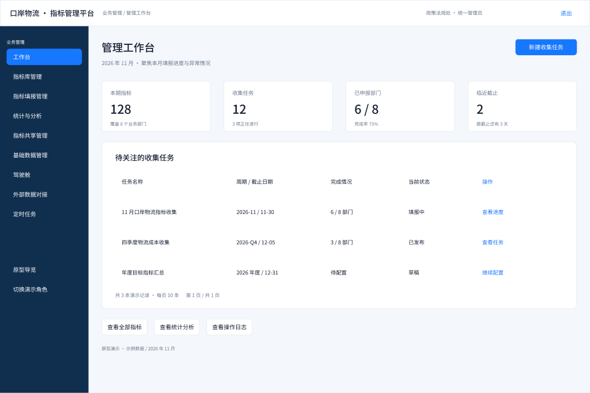
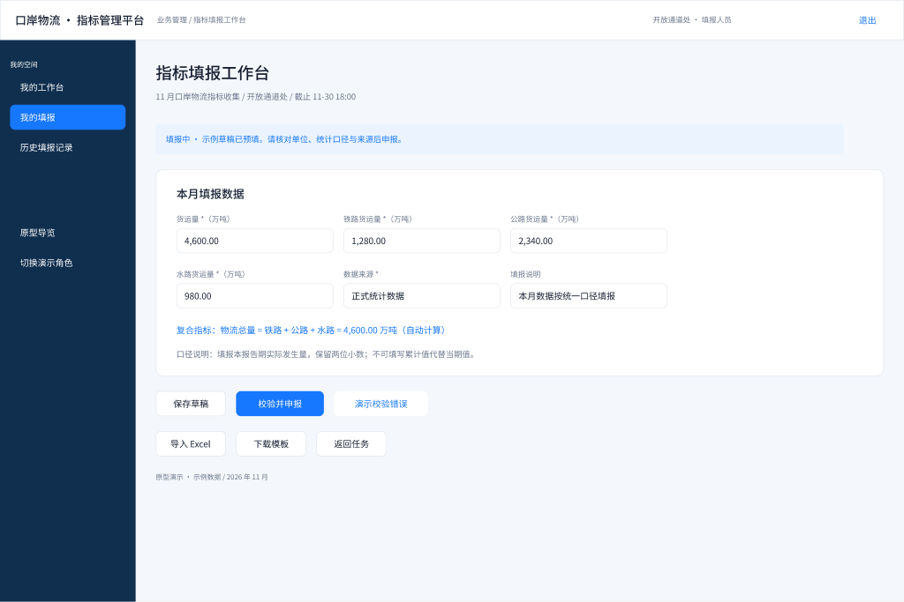
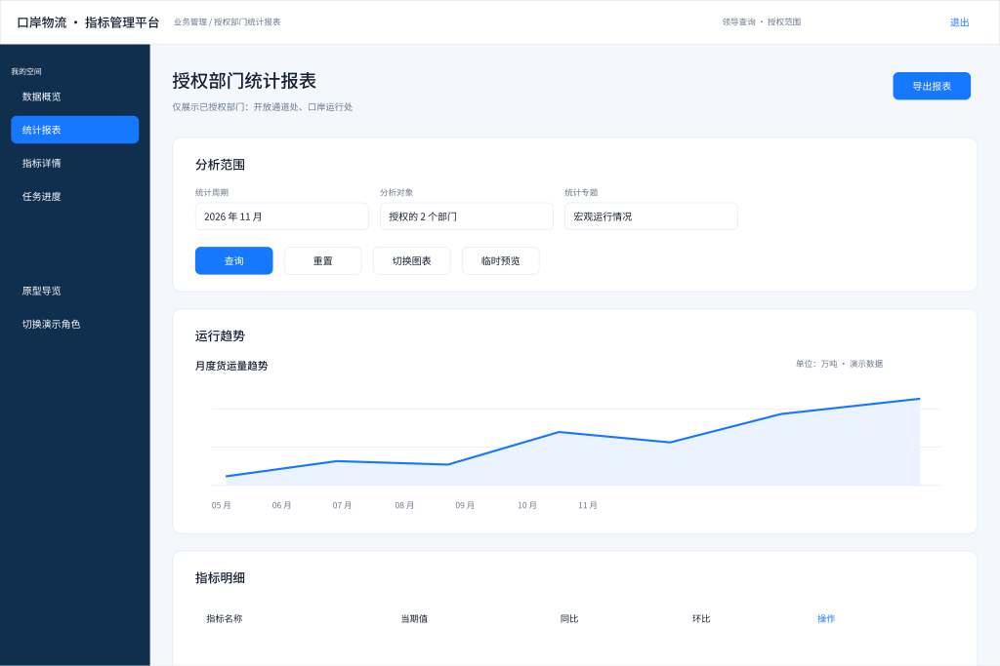

# Figma 原型归档

归档日期：2026-11-24。原设计共 37 个业务/状态页面、50 个弹窗/反馈状态、4 个规划与导览画板。本次成功归档 59 张截图；另 32 个画板因 Figma MCP 套餐调用额度上限仅提供直达链接，见下方清单。

- [可点击原型](https://www.figma.com/proto/yTKn40CTJ1fL8CSur9ApcQ?node-id=3-2&starting-point-node-id=3%3A2)
- [可编辑设计文件](https://www.figma.com/design/yTKn40CTJ1fL8CSur9ApcQ?node-id=3-2)

本目录 PNG 为 Figma 工具生成的静态截图，最长边不超过 1024 像素。可编辑图层、按钮交互与完整分辨率请打开 Figma；仓库未包含 `.fig` 源文件。图片为演示数据，不是生产系统截图。原型中的预设输入、后台处理和下载反馈不代表真实接口已经实现。

## 页面预览

### 管理工作台

### 处室填报

### 授权部门统计

## 全部画板索引

### 产品规划与导览

| 名称 | 图片 | Figma 源页面 |
| --- | --- | --- |
| G00｜原型导览与产品定位 | [查看](planning/G00.png) | [打开](https://www.figma.com/design/yTKn40CTJ1fL8CSur9ApcQ?node-id=3-2) |
| G01｜产品策划 / 从指标口径到有效数据 | [查看](planning/G01.png) | [打开](https://www.figma.com/design/yTKn40CTJ1fL8CSur9ApcQ?node-id=9-1493) |

### 业务页面与状态

| 名称 | 图片 | Figma 源页面 |
| --- | --- | --- |
| P01｜登录与演示角色选择 | [查看](screens/P01.png) | [打开](https://www.figma.com/design/yTKn40CTJ1fL8CSur9ApcQ?node-id=3-23) |
| P02｜管理工作台 | [查看](screens/P02.png) | [打开](https://www.figma.com/design/yTKn40CTJ1fL8CSur9ApcQ?node-id=3-52) |
| P03｜指标库管理 | [查看](screens/P03.png) | [打开](https://www.figma.com/design/yTKn40CTJ1fL8CSur9ApcQ?node-id=3-145) |
| P04｜指标详情 | [查看](screens/P04.png) | [打开](https://www.figma.com/design/yTKn40CTJ1fL8CSur9ApcQ?node-id=3-245) |
| P05｜新增 / 编辑指标 | [查看](screens/P05.png) | [打开](https://www.figma.com/design/yTKn40CTJ1fL8CSur9ApcQ?node-id=3-328) |
| P06｜部门指标库 | [查看](screens/P06.png) | [打开](https://www.figma.com/design/yTKn40CTJ1fL8CSur9ApcQ?node-id=3-405) |
| P07｜复合指标组装 | [查看](screens/P07.png) | [打开](https://www.figma.com/design/yTKn40CTJ1fL8CSur9ApcQ?node-id=4-235) |
| P08｜申报周期管理 | [查看](screens/P08.png) | [打开](https://www.figma.com/design/yTKn40CTJ1fL8CSur9ApcQ?node-id=4-332) |
| P09｜收集任务管理 | [查看](screens/P09.png) | [打开](https://www.figma.com/design/yTKn40CTJ1fL8CSur9ApcQ?node-id=4-417) |
| P10｜新建收集任务 | [查看](screens/P10.png) | [打开](https://www.figma.com/design/yTKn40CTJ1fL8CSur9ApcQ?node-id=4-513) |
| P11｜任务详情与进度 | [查看](screens/P11.png) | [打开](https://www.figma.com/design/yTKn40CTJ1fL8CSur9ApcQ?node-id=4-605) |
| P12｜部门填报详情 | [查看](screens/P12.png) | [打开](https://www.figma.com/design/yTKn40CTJ1fL8CSur9ApcQ?node-id=4-702) |
| P13｜历史填报记录 | [查看](screens/P13.png) | [打开](https://www.figma.com/design/yTKn40CTJ1fL8CSur9ApcQ?node-id=4-782) |
| P14｜版本追溯与差异对比 | [查看](screens/P14.png) | [打开](https://www.figma.com/design/yTKn40CTJ1fL8CSur9ApcQ?node-id=4-871) |
| P15｜统计与分析 | [查看](screens/P15.png) | [打开](https://www.figma.com/design/yTKn40CTJ1fL8CSur9ApcQ?node-id=5-594) |
| P16｜货运量 · 指标分析 | [查看](screens/P16.png) | [打开](https://www.figma.com/design/yTKn40CTJ1fL8CSur9ApcQ?node-id=5-778) |
| P17｜指标共享管理 | [查看](screens/P17.png) | [打开](https://www.figma.com/design/yTKn40CTJ1fL8CSur9ApcQ?node-id=5-914) |
| P18｜基础数据管理 | [查看](screens/P18.png) | [打开](https://www.figma.com/design/yTKn40CTJ1fL8CSur9ApcQ?node-id=5-998) |
| P19｜口岸物流驾驶舱 | [查看](screens/P19.png) | [打开](https://www.figma.com/design/yTKn40CTJ1fL8CSur9ApcQ?node-id=5-1083) |
| P20｜外部数据对接 | [查看](screens/P20.png) | [打开](https://www.figma.com/design/yTKn40CTJ1fL8CSur9ApcQ?node-id=5-1163) |
| P21｜定时任务管理 | [查看](screens/P21.png) | [打开](https://www.figma.com/design/yTKn40CTJ1fL8CSur9ApcQ?node-id=5-1239) |
| P22｜我的填报工作台 | [查看](screens/P22.png) | [打开](https://www.figma.com/design/yTKn40CTJ1fL8CSur9ApcQ?node-id=7-938) |
| P23｜指标填报工作台 | [查看](screens/P23.png) | [打开](https://www.figma.com/design/yTKn40CTJ1fL8CSur9ApcQ?node-id=7-1012) |
| P24｜Excel 导入预校验 | [查看](screens/P24.png) | [打开](https://www.figma.com/design/yTKn40CTJ1fL8CSur9ApcQ?node-id=7-1084) |
| P25｜导入校验通过 | [查看](screens/P25.png) | [打开](https://www.figma.com/design/yTKn40CTJ1fL8CSur9ApcQ?node-id=7-1146) |
| P26｜已申报详情 | [查看](screens/P26.png) | [打开](https://www.figma.com/design/yTKn40CTJ1fL8CSur9ApcQ?node-id=7-1183) |
| P27｜数据概览 | [查看](screens/P27.png) | [打开](https://www.figma.com/design/yTKn40CTJ1fL8CSur9ApcQ?node-id=7-1251) |
| P28｜授权部门统计报表 | [查看](screens/P28.png) | [打开](https://www.figma.com/design/yTKn40CTJ1fL8CSur9ApcQ?node-id=5-691) |
| P29｜货运量 · 指标分析 | [查看](screens/P29.png) | [打开](https://www.figma.com/design/yTKn40CTJ1fL8CSur9ApcQ?node-id=5-851) |
| P36｜指标查询 · 无结果 | [查看](screens/P36.png) | [打开](https://www.figma.com/design/yTKn40CTJ1fL8CSur9ApcQ?node-id=7-1315) |
| P37｜指标查询结果 | [查看](screens/P37.png) | [打开](https://www.figma.com/design/yTKn40CTJ1fL8CSur9ApcQ?node-id=7-1375) |
| P38｜任务详情 · 已锁定 | [查看](screens/P38.png) | [打开](https://www.figma.com/design/yTKn40CTJ1fL8CSur9ApcQ?node-id=7-1443) |
| P40｜授权部门任务进度 | [查看](screens/P40.png) | [打开](https://www.figma.com/design/yTKn40CTJ1fL8CSur9ApcQ?node-id=7-1508) |
| P42｜常量字典管理 | [查看](screens/P42.png) | [打开](https://www.figma.com/design/yTKn40CTJ1fL8CSur9ApcQ?node-id=7-1578) |
| P43｜操作与运行日志 | [查看](screens/P43.png) | [打开](https://www.figma.com/design/yTKn40CTJ1fL8CSur9ApcQ?node-id=7-1652) |
| P44｜指标共享记录 | [查看](screens/P44.png) | [打开](https://www.figma.com/design/yTKn40CTJ1fL8CSur9ApcQ?node-id=7-1744) |

### 弹窗与反馈

| 名称 | 图片 | Figma 源页面 |
| --- | --- | --- |
| D_ASSIGN｜选择指标与责任部门 | [查看](dialogs/D_ASSIGN.png) | [打开](https://www.figma.com/design/yTKn40CTJ1fL8CSur9ApcQ?node-id=8-1369) |
| D_CALC｜公式试算通过 | [查看](dialogs/D_CALC.png) | [打开](https://www.figma.com/design/yTKn40CTJ1fL8CSur9ApcQ?node-id=8-1399) |
| D_DRAFT｜草稿已保存 | [查看](dialogs/D_DRAFT.png) | [打开](https://www.figma.com/design/yTKn40CTJ1fL8CSur9ApcQ?node-id=8-1437) |
| D_EXTEND｜延期开放填报 | [查看](dialogs/D_EXTEND.png) | [打开](https://www.figma.com/design/yTKn40CTJ1fL8CSur9ApcQ?node-id=8-1469) |
| D_IMPORT_LIBRARY｜导入部门指标库 | [查看](dialogs/D_IMPORT_LIBRARY.png) | [打开](https://www.figma.com/design/yTKn40CTJ1fL8CSur9ApcQ?node-id=8-1385) |
| D_IND_SAVED｜指标保存成功 | [查看](dialogs/D_IND_SAVED.png) | [打开](https://www.figma.com/design/yTKn40CTJ1fL8CSur9ApcQ?node-id=8-1355) |
| D_LOCK｜确认锁定任务 | [查看](dialogs/D_LOCK.png) | [打开](https://www.figma.com/design/yTKn40CTJ1fL8CSur9ApcQ?node-id=8-1485) |
| D_PERIOD_CANCEL｜确认取消发布 | [查看](dialogs/D_PERIOD_CANCEL.png) | [打开](https://www.figma.com/design/yTKn40CTJ1fL8CSur9ApcQ?node-id=8-1428) |
| D_PERIOD｜确认发布申报周期 | [查看](dialogs/D_PERIOD.png) | [打开](https://www.figma.com/design/yTKn40CTJ1fL8CSur9ApcQ?node-id=8-1420) |
| D_PICK｜选择字段值 | [查看](dialogs/D_PICK.png) | [打开](https://www.figma.com/design/yTKn40CTJ1fL8CSur9ApcQ?node-id=8-1322) |
| D_PUBLISH｜确认发布收集任务 | [查看](dialogs/D_PUBLISH.png) | [打开](https://www.figma.com/design/yTKn40CTJ1fL8CSur9ApcQ?node-id=8-1445) |
| D_RECALC_OK｜重算完成 | [查看](dialogs/D_RECALC_OK.png) | [打开](https://www.figma.com/design/yTKn40CTJ1fL8CSur9ApcQ?node-id=8-1412) |
| D_RECALC｜确认级联重算 | [查看](dialogs/D_RECALC.png) | [打开](https://www.figma.com/design/yTKn40CTJ1fL8CSur9ApcQ?node-id=8-1404) |
| D_REGISTER_OK｜注册信息已提交 | [查看](dialogs/D_REGISTER_OK.png) | [打开](https://www.figma.com/design/yTKn40CTJ1fL8CSur9ApcQ?node-id=8-1350) |
| D_REGISTER｜用户注册 | [查看](dialogs/D_REGISTER.png) | [打开](https://www.figma.com/design/yTKn40CTJ1fL8CSur9ApcQ?node-id=8-1330) |
| D_REMIND_OK｜提醒已发送 | [查看](dialogs/D_REMIND_OK.png) | [打开](https://www.figma.com/design/yTKn40CTJ1fL8CSur9ApcQ?node-id=8-1461) |
| D_REMIND｜确认发送任务提醒 | [查看](dialogs/D_REMIND.png) | [打开](https://www.figma.com/design/yTKn40CTJ1fL8CSur9ApcQ?node-id=8-1453) |
| D_RUN_JOB｜立即触发定时任务 | [查看](dialogs/D_RUN_JOB.png) | [打开](https://www.figma.com/design/yTKn40CTJ1fL8CSur9ApcQ?node-id=8-1677) |
| D_SAVED｜保存成功 | [查看](dialogs/D_SAVED.png) | [打开](https://www.figma.com/design/yTKn40CTJ1fL8CSur9ApcQ?node-id=8-1394) |
| D_TEMPLATE｜填报模板已准备 | [查看](dialogs/D_TEMPLATE.png) | [打开](https://www.figma.com/design/yTKn40CTJ1fL8CSur9ApcQ?node-id=8-1550) |
| D_VALIDATION｜请先修正必填项 | [查看](dialogs/D_VALIDATION.png) | [打开](https://www.figma.com/design/yTKn40CTJ1fL8CSur9ApcQ?node-id=8-1363) |

### 尚未导出图片的画板

这些画板仍可通过 Figma 查看；未以空图片替代。

| 名称 | Figma 源页面 |
| --- | --- |
| D_UNLOCK｜解锁并开放任务 | [打开](https://www.figma.com/design/yTKn40CTJ1fL8CSur9ApcQ?node-id=8-1493) |
| D_CORRECT｜开放部门更正 | [打开](https://www.figma.com/design/yTKn40CTJ1fL8CSur9ApcQ?node-id=8-1509) |
| D_CORRECT_OK｜已开放更正 | [打开](https://www.figma.com/design/yTKn40CTJ1fL8CSur9ApcQ?node-id=8-1525) |
| D_ROLLBACK｜确认版本回退 | [打开](https://www.figma.com/design/yTKn40CTJ1fL8CSur9ApcQ?node-id=8-1533) |
| D_EXPORT｜导出任务已创建 | [打开](https://www.figma.com/design/yTKn40CTJ1fL8CSur9ApcQ?node-id=8-1545) |
| D_SUBMIT｜确认申报本期数据 | [打开](https://www.figma.com/design/yTKn40CTJ1fL8CSur9ApcQ?node-id=8-1555) |
| D_WITHDRAW｜确认取消申报 | [打开](https://www.figma.com/design/yTKn40CTJ1fL8CSur9ApcQ?node-id=8-1563) |
| D_AUTH｜用户角色与数据范围 | [打开](https://www.figma.com/design/yTKn40CTJ1fL8CSur9ApcQ?node-id=8-1571) |
| D_USER｜新增用户 | [打开](https://www.figma.com/design/yTKn40CTJ1fL8CSur9ApcQ?node-id=8-1591) |
| D_DEPT｜部门信息维护 | [打开](https://www.figma.com/design/yTKn40CTJ1fL8CSur9ApcQ?node-id=8-1611) |
| D_MENU｜角色菜单配置 | [打开](https://www.figma.com/design/yTKn40CTJ1fL8CSur9ApcQ?node-id=8-1627) |
| D_DICT｜编辑常量字典项 | [打开](https://www.figma.com/design/yTKn40CTJ1fL8CSur9ApcQ?node-id=8-1635) |
| D_CACHE｜字典缓存已刷新 | [打开](https://www.figma.com/design/yTKn40CTJ1fL8CSur9ApcQ?node-id=8-1651) |
| D_SYSTEM｜系统信息 | [打开](https://www.figma.com/design/yTKn40CTJ1fL8CSur9ApcQ?node-id=8-1656) |
| D_SOURCE｜外部数据详情 | [打开](https://www.figma.com/design/yTKn40CTJ1fL8CSur9ApcQ?node-id=8-1661) |
| D_RUN_SOURCE｜确认执行外部数据任务 | [打开](https://www.figma.com/design/yTKn40CTJ1fL8CSur9ApcQ?node-id=8-1669) |
| D_JOB_OK｜执行请求已受理 | [打开](https://www.figma.com/design/yTKn40CTJ1fL8CSur9ApcQ?node-id=8-1685) |
| D_PAUSE｜暂停后续调度 | [打开](https://www.figma.com/design/yTKn40CTJ1fL8CSur9ApcQ?node-id=8-1693) |
| D_PAUSE_OK｜定时计划已暂停 | [打开](https://www.figma.com/design/yTKn40CTJ1fL8CSur9ApcQ?node-id=8-1701) |
| D_RESUME｜确认恢复调度 | [打开](https://www.figma.com/design/yTKn40CTJ1fL8CSur9ApcQ?node-id=8-1709) |
| D_DELETE_JOB｜暂不可删除 | [打开](https://www.figma.com/design/yTKn40CTJ1fL8CSur9ApcQ?node-id=8-1717) |
| D_SHARE_DETAIL｜共享批次详情 | [打开](https://www.figma.com/design/yTKn40CTJ1fL8CSur9ApcQ?node-id=8-1722) |
| D_CHART｜图表切换 | [打开](https://www.figma.com/design/yTKn40CTJ1fL8CSur9ApcQ?node-id=8-1730) |
| D_PREVIEW｜报表临时预览 | [打开](https://www.figma.com/design/yTKn40CTJ1fL8CSur9ApcQ?node-id=8-1738) |
| D_COCKPIT｜专题数据详情 | [打开](https://www.figma.com/design/yTKn40CTJ1fL8CSur9ApcQ?node-id=8-1746) |
| D_COCKPIT_RESULT｜专题查询结果 | [打开](https://www.figma.com/design/yTKn40CTJ1fL8CSur9ApcQ?node-id=8-1762) |
| P39｜任务详情 · 锁定成功 | [打开](https://www.figma.com/design/yTKn40CTJ1fL8CSur9ApcQ?node-id=8-1767) |
| G02｜交互规则 / 状态与按钮约定 | [打开](https://www.figma.com/design/yTKn40CTJ1fL8CSur9ApcQ?node-id=9-1537) |
| G03｜功能范围 / 九个模块的原型映射 | [打开](https://www.figma.com/design/yTKn40CTJ1fL8CSur9ApcQ?node-id=9-1598) |
| D_QUERY｜查询完成 | [打开](https://www.figma.com/design/yTKn40CTJ1fL8CSur9ApcQ?node-id=10-1651) |
| D_RESET｜筛选已重置 | [打开](https://www.figma.com/design/yTKn40CTJ1fL8CSur9ApcQ?node-id=10-1656) |
| D_CHART_TABLE｜明细表预览 | [打开](https://www.figma.com/design/yTKn40CTJ1fL8CSur9ApcQ?node-id=21-1603) |

图片尺寸、来源节点和校验值见 [index.json](index.json)。
